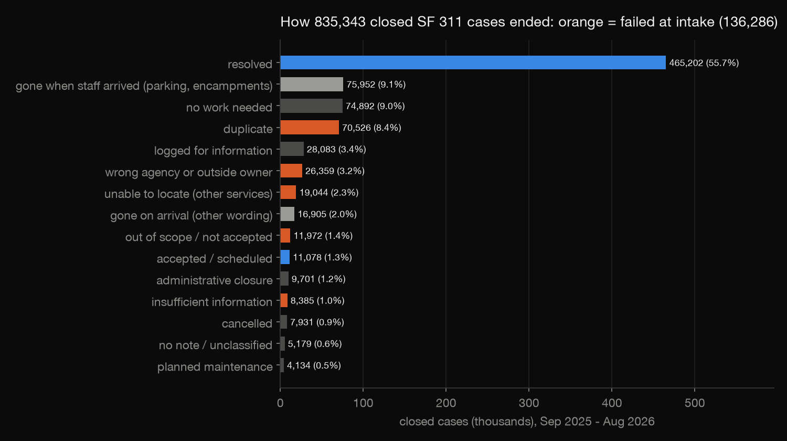
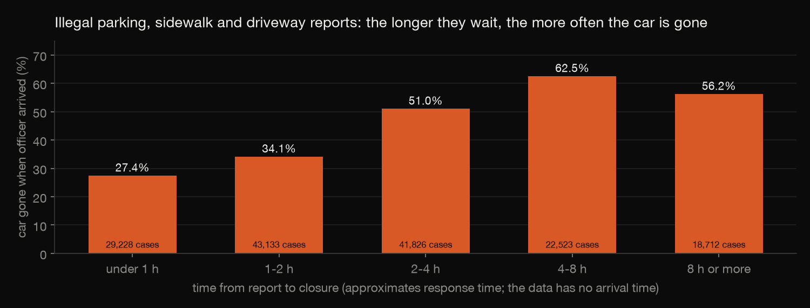
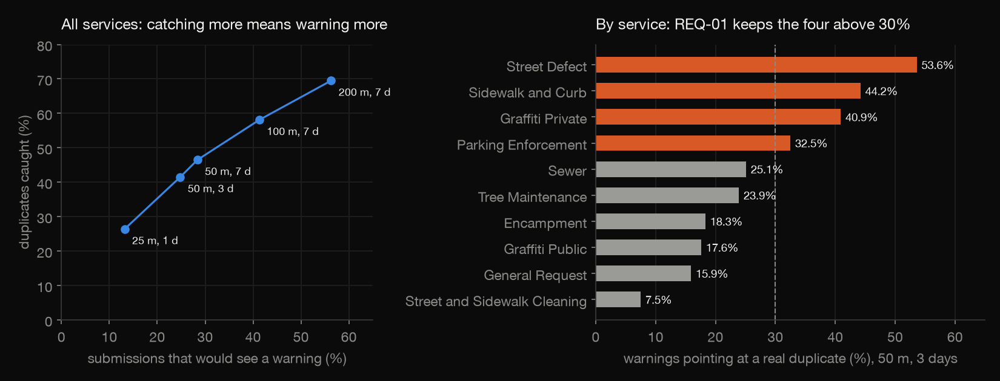
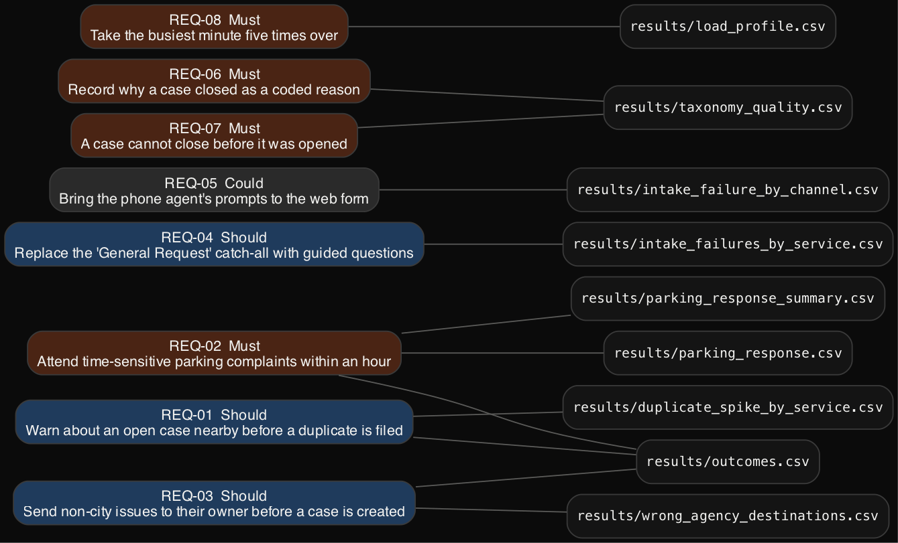

# SF 311 intake requirements, built from a year of cases

Requirements analysis for San Francisco's 311 front door (app, web form, phone), with every requirement traced to
evidence in a year of real cases. The project:
- measures how 835,343 closed cases ended;
- finds where intake fails;
- tests candidate fixes against the data before writing them down;
- writes 8 requirements with acceptance criteria and proposed targets, and records 3 candidates the data rejected.

Build log: https://mrrishit909.github.io/projects/sf311-requirements/

This is an independent portfolio project: San Francisco did not commission it, and no stakeholders were interviewed.
Needs come from the data and from the City's own closure notes. Targets are proposals.

## Data

DataSF *311 Cases* (`vw6y-z8j6`), cases requested 1 September 2025 – 31 August 2026:
- 872,450 rows, snapshot of 1 October 2026 (`results/pull.json`);
- `download.py` pulls one month per request.

Rows are not committed, because they carry addresses. Only aggregates are in `results/`.

## Steps

| Step | File | What it does |
|---|---|---|
| 1 | `download.py` | freeze one snapshot |
| 2-3 | `sql/01_cases.sql`, `rules/outcomes.csv`, `sql/02_evidence.sql`, `evidence.py` | clean (drop 625 test cases and 1,458 with no channel); classify how each closed case ended with 14 ordered text rules (99.38% classified); measure the evidence |
| 4 | `sql/03_duplicate_spike.sql`, `spike.py` | could the form have warned about a duplicate? Five radius/window settings, by service |
| 5 | `requirements.yaml`, `spec.py` | the requirements, one file as the source; `spec.py` checks every cited number against `results/` and writes `docs/requirements.md` and `results/traceability.csv` |
| 6 | `check.py` | recomputes the evidence a second way, in pandas, from the raw pull |
| 7 | `charts.py` | charts |

Run: `python3 -m venv venv && ./venv/bin/pip install pandas duckdb pyarrow pyyaml matplotlib certifi`, then
`./venv/bin/python download.py && ./venv/bin/python evidence.py && ./venv/bin/python spike.py && ./venv/bin/python spec.py && ./venv/bin/python check.py && ./venv/bin/python charts.py`.

## What the evidence says

**Intake failures.** 136,286 closed cases (16.3%) ended in ways a better front door could prevent:

| Outcome | Cases |
|---|---|
| duplicate | 70,526 |
| wrong agency or outside owner | 26,359 |
| unable to locate | 19,044 |
| out of scope | 11,972 |
| insufficient information | 8,385 |

**"Unable to Locate" usually means "gone".** On parking and encampment cases it closes 75,952 cases, and it means the
car or the people had left. Those are reclassified as "gone when staff arrived". For illegal-parking, sidewalk and
driveway complaints, the share of cars gone rises from 27.4% when a case closes within an hour to 62.5% at 4–8 hours.
Only 18.8% close within an hour.

**Duplicate warning: scope decides.** Warning about any open case of the same type within 50 m in the last 3 days would
catch 41.5% of duplicates, but it would warn on 24.8% of all submissions. By service, the share of warnings that point
at a case later closed as a duplicate differs a lot:

| Service | Warnings pointing at a real duplicate |
|---|---|
| Street Defect | 53.6% |
| Sidewalk and Curb | 44.2% |
| Graffiti Private | 40.9% |
| Parking Enforcement | 32.5% |
| Street and Sidewalk Cleaning | 7.5% |

**Channels.** Allowing for what each channel is used for, web reports fail at intake 1.08 times as often as expected,
and phone reports, where an agent asks the questions, 0.87 times.

**Free-text closures.** The year has 243,054 different closure notes, including 128,370 different ways of writing
"resolved". 4,749 closed cases have no note, and 1,451 closed before they were opened.

## Requirements

`docs/requirements.md` has each requirement in full: problem, statement, Given/When/Then acceptance criteria, proposed
target and evidence.

| ID | Priority | Requirement |
|---|---|---|
| REQ-01 | Should | Warn about an open case nearby before a duplicate is filed (four services only) |
| REQ-02 | Must | Attend time-sensitive parking complaints within an hour (50%; baseline 18.8%) |
| REQ-03 | Should | Send non-city issues (USPS, PG&E, State, police non-emergency) to their owner before a case is created |
| REQ-04 | Should | Replace the "General Request" catch-all (43.1% intake failure) with guided questions |
| REQ-05 | Could | Bring the phone agent's prompts to the web form (A/B test) |
| REQ-06 | Must | Record why a case closed as a coded reason |
| REQ-07 | Must | A case cannot close before it was opened |
| REQ-08 | Must | Take 530 submissions a minute (5 × the peak of 106) |

**Rejected, with evidence:**
- **REJ-01, a mandatory map pin.** Cases without coordinates end "unable to locate" 3.37% of the time, against 3.07% with coordinates.
- **REJ-02, a mandatory photo.** Observed matches expected.
- **REJ-03, a duplicate warning for street cleaning.** Only 7.5% of its warnings would point at a real duplicate.

## The checks

`spec.py` refuses to build the document if:
- a cited value differs from its results file;
- a count or percentage in a problem statement isn't one of the cited values;
- an acceptance criterion is neither a Given/When/Then scenario nor a measured threshold.

`check.py` recomputes, independently, from the raw pull:
- the exclusions;
- the 14 outcome rules, re-applied with Python's `re`;
- the parking curve, the closed-before-opened count and the busiest minute;
- the duplicate spike's grid join, against a brute-force distance check on 400 random cases.

It caught one real bug: `date_diff('minute', …)` counts minute boundaries crossed, not elapsed time.

## Not done

- No stakeholder interviews or workshops; the data shows where intake fails, not why residents chose what they did.
- The closure taxonomy is built from text rules. "No work needed" (74,892) is ambiguous and is not counted as an intake failure.
- Hours to close stands in for response time; the data has no arrival time, and REQ-02 asks for one.
- Web attachment links point to a form endpoint whose contents are unknown, so the photo comparison uses mobile reports only.
- No prototype of the form.
